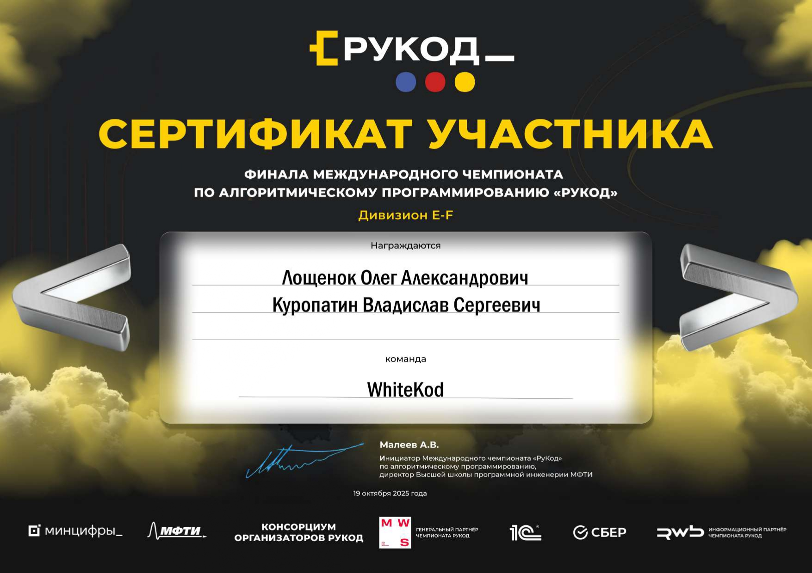
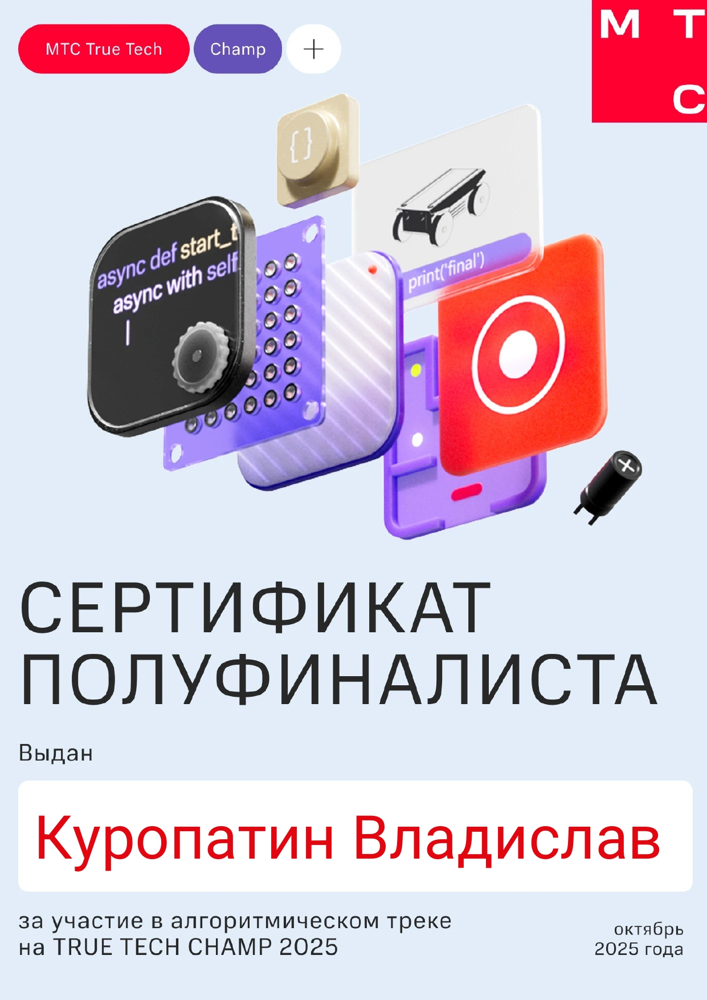
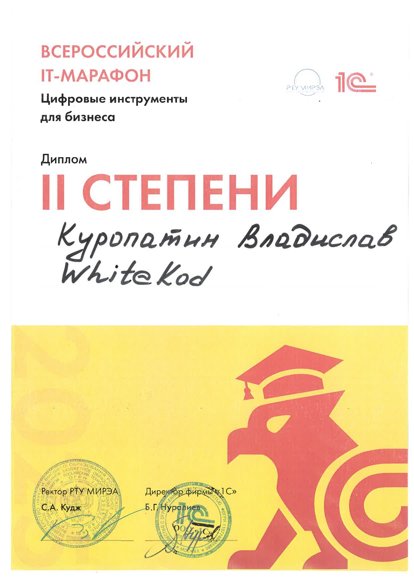
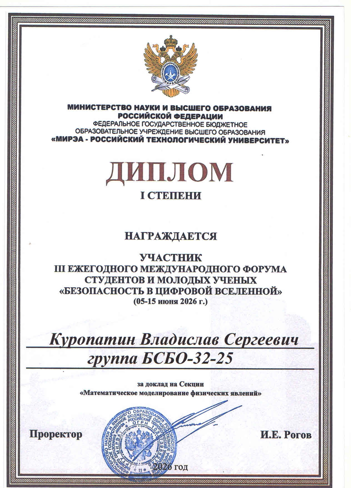
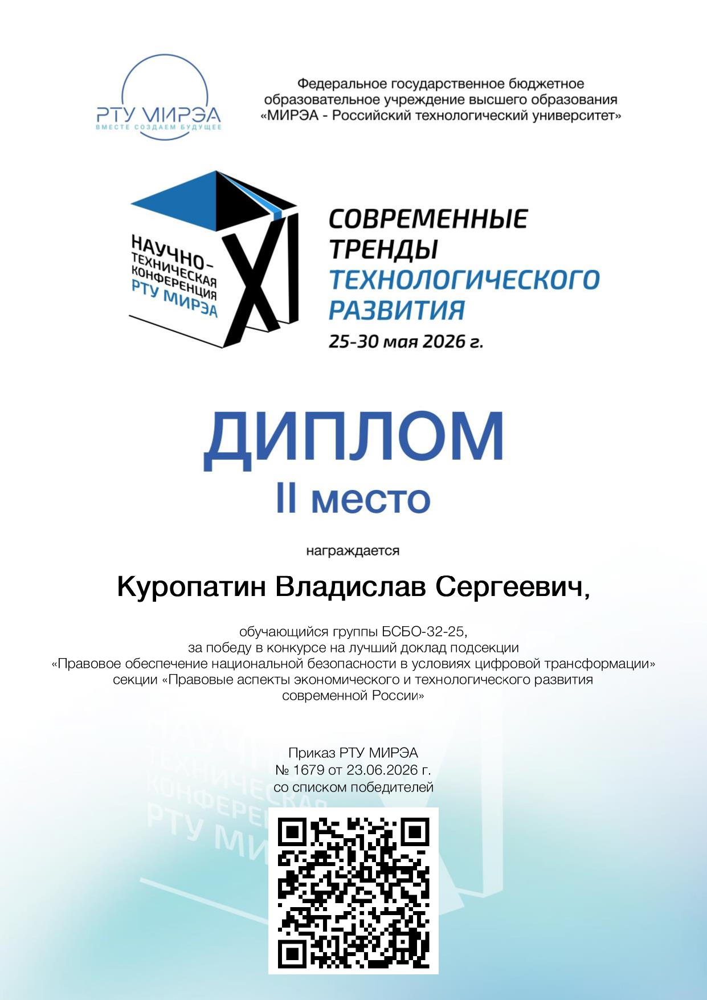

# Hi, my nickname is Morda! 🦊

## Сменить язык: [Русский](README.md)

---

## 🧑‍💻 About me

Hi! My name is **Vladislav Sergeevich Kuropatin**, I am a developer and a student at RTU MIREA. My journey in IT began with a passion for development and a desire to create digital products with my own hands. I constantly learn new technologies and study new trends in the IT field.

My main stack is **C++ 17/20** (from low-level memory management and design patterns to complex numerical algorithms) and **Data Science** (building ML pipelines, neural networks, data analysis in Python). C++ impressed and interested me in the very first days of getting acquainted with it due to its complexity and the ability to control the entire program. What is implicit and hidden by magic in other programming languages surfaces here in its true form. I develop in Python (Data Science) as part of my research activities thanks to the language's rich ecosystem. I enjoy analyzing large volumes of data and designing ML models to solve business problems.

In my free time, I like to relax in video games, enjoy nature, and disassemble off-road motorcycles. I strive to become a professional in programming and analytics, so I am open to new knowledge and experience.

Please take a look at my resume:

You can also visit my portfolio website: [https://mordaredfox.github.io/](https://mordaredfox.github.io/)

---

## 🎓 Education

**RTU MIREA** (2025 – 2029, Moscow) – *2nd year*
*   Field of study: "Information Systems and Technologies" (09.03.02), Bachelor's degree.
*   Program: "Development of Cross-platform Business Applications".

**Additional education:**
*   "Cybersecurity of Data, OS and Applications" – elite training at RTU MIREA (2025 – 2026).
*   Online courses from the Sirius Educational Center: "Introduction to
Algorithms in C++", "Introduction to ML", "Deep Learning", "Natural Language Processing (NLP)", "Data Analysis in Python".

---

## 🛠 Tech Stack

### 💻 Programming Languages

    
    
    
    
    
    
    
    

### ⚙️ C++ / System Development

    
    
    
    
    
    
    
    
    

### 📊 Data Science / ML

    
    
    
    
    
    
    
    
    
    

### 🛠 Infrastructure and Tools

    
    
    
    
    
    
    
    

### 🌐 Networks and APIs

    
    
    
    
    
    

### 📖 Currently Learning / Plans

    
    
    
    
    
    
    
    

---

## 🏆 Achievements

*   🥇 **Finalist** of the international algorithmic programming championship "RuCode", 2025.

*   🏅 **Semifinalist** of the All-Russian MTS True Tech Champ 2025 championship in the algorithmic programming section.

*   🏆 **Winner (2nd degree diploma)** of the hackathon "All-Russian IT Marathon: Digital Tools for Business" 2025, case "Intelligent Sales Manager Assistant".

*   🎓 **1st degree diploma** of the III Annual International Forum of Students and Young Scientists "Security in the Digital Universe", 2026 (developed a numerical integrator of an interplanetary flight trajectory with visualization in Python).

*   📜 **2nd degree diploma** of the XI Scientific and Technical Conference of Students and Postgraduates of RTU MIREA "Modern Trends in Technological Development", 2026 (developed an AI model in Python for predicting the effectiveness of anti-sanction measures for technology companies of the Russian Federation).

*   📝 **Publication** of a scientific article "Numerical Modeling of a Flight to Titan with a Gravitational Maneuver at Saturn" in the collection of the IV Interdepartmental Scientific and Technical Conference (Moscow, 2026). – [Read on eLibrary](https://elibrary.ru/item.asp?id=91813258)

---

## 📂 My Projects

Here you will find:
- 🏫 Educational projects from the university (C++ / Python)
- 🔬 Personal experiments in development and Data Science
- 📊 Research works on modeling and ML

---

## 📩 Contacts

&nbsp;

> "Don't worry if something doesn't work. If everything worked, you'd be fired." © Mosher's Law of Software Engineering
